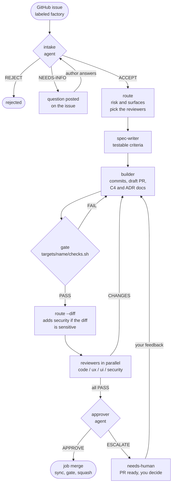
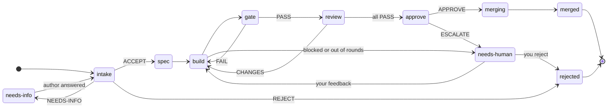
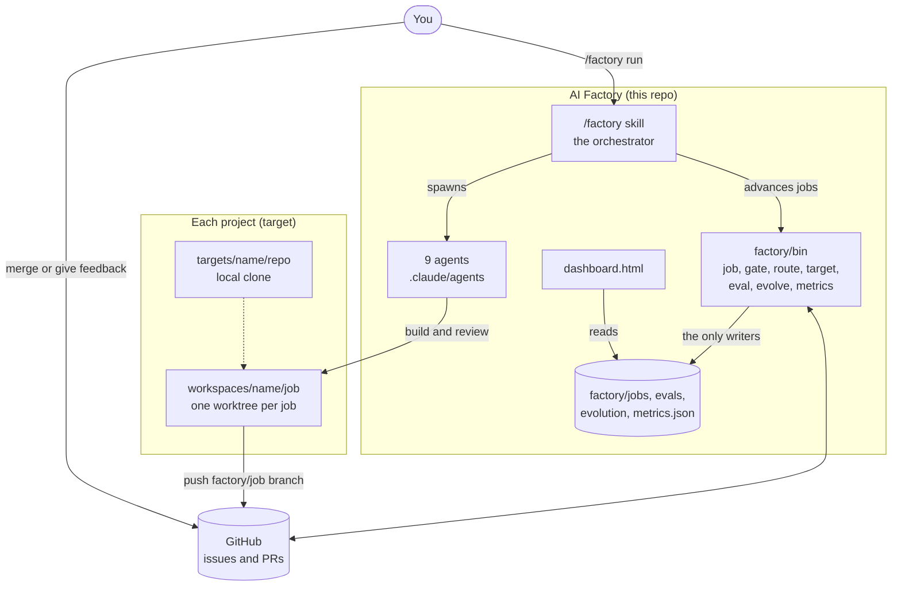
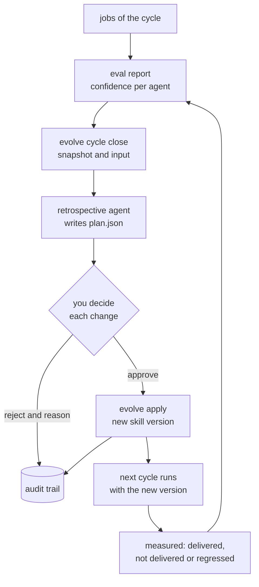

# AI Factory

A software factory driven by Claude Code: a GitHub issue labeled `factory` becomes a pull request
(intake → spec → build → gate → parallel reviewers → approver). The factory lives **here** and works on
as many projects as you like; the projects only receive PRs. Fork of ZazenCodes' v2, see [`docs/ORIGIN.md`](docs/ORIGIN.md).


## Where to read what

The **[manual](docs/manuel-factory.html)** (English and French, interactive, with a loop and a KPI explorer) is the
place to learn the factory. It is an HTML page: open it from a clone (`open docs/manuel-factory.html`), or
[view it in the browser](https://htmlpreview.github.io/?https://github.com/nmarchand73/ai-factory/blob/main/docs/manuel-factory.html)
(a third-party viewer, since GitHub shows HTML as source).

| I want to... | Go to |
|---|---|
| Understand what the factory does and why | manual, *Understand* (`docs/manuel-factory.html#understand`) |
| Set up my first project and run an issue | manual, *Get started* (`#start`), and the quick start below |
| Run it day to day, answer jobs that need me | manual, *Day to day* (`#day`) |
| Read the health board, scores and the improvement loop | manual, *Measure & improve* (`#improve`) |
| Fix something that went wrong | manual, *Troubleshooting* (`#faq`) |
| Keep the commands at hand | manual, *Cheat sheet* (`#memo`) |
| Know how each agent is judged | [`docs/EVALS.md`](docs/EVALS.md) |
| Know how skills change after a retrospective | [`docs/EVOLUTION.md`](docs/EVOLUTION.md) |
| Know what each health KPI means | [`docs/HEALTH.md`](docs/HEALTH.md) |
| Work on the factory itself (rules, scripts, tests) | [`AGENTS.md`](AGENTS.md) |

## How it works

One issue becomes one pull request. Every arrow is a script in `factory/bin/` or an agent in `.claude/agents/`; the
orchestrator (the `/factory` skill) only moves a job to the next step, and the scripts refuse illegal moves.



A job has at most `max_rounds` build rounds; a round is one build, gate and review pass. The states a job moves through:



Where things live: the factory is its own repo, and the projects only receive PRs.



The factory also improves itself. After each run (a cycle) a retrospective proposes changes and **you approve each one**:



The [manual](docs/manuel-factory.html#understand) walks through the same pipeline step by step.

## Quick start

```bash
factory/bin/target add my-project owner/repo      # clone, labels, checks.sh and notes.md to complete
$EDITOR targets/my-project/checks.sh targets/my-project/notes.md
factory/bin/target check my-project               # must end with "target is ready"
gh issue edit 12 --repo owner/repo --add-label factory
claude                                            # at the root of THIS repo
> /factory run my-project#12                      # or /factory run
```

Always launch from this repo, never from a project, and **start a fresh session for each run** (the orchestrator's
cost is its context size times its turns; see *Cost report*). Several projects run side by side: `/factory run` drains
every project's queue (`concurrency` jobs at a time, shared), `/factory run <project>` one project,
`/factory run <project>#<n>` one issue.

## Dashboard

`cd factory && python3 -m http.server`, then <http://localhost:8000/dashboard.html>.

- one swimlane per project, most recently active first, stages as columns, jobs as cards with a chip per round (gate, code, ux, ui, security);
- retire a project with `factory/bin/target archive <name>`: it is no longer queued or built and its lane hides behind an
  **Archived** chip (its jobs and history stay); `target unarchive <name>` brings it back;
- GitHub links everywhere: issue and PR pills, **Open PR to merge** on jobs that need you, **Open issue to answer**
  on jobs waiting for their author, the repo in each lane header;
- cumulative cost per project, spread per step and per agent (including the orchestrator session);
- the tab title shows how many jobs need you, and an optional browser notification fires when one starts waiting;
- the Done column shows the latest 5 jobs per project (the cost still counts all of them).

More in the manual: [Day to day](docs/manuel-factory.html#day).

## Agent evals and confidence

Every agent has a confidence score (0-100) built from two composite metrics:

- **process**, how it works;
- **output**, how good what it produces is.

The criteria are written for each agent's own assignment, not shared: an intake is judged on looking at the code
before deciding, on treating the issue as data and on asking little; a builder on running the checks and never
weakening a test; a security reviewer on tracing input to sinks and on findings that give vector, fix and CWE; an
approver on re-reading the evidence and on naming the escalation triggers it checked. Each criterion is a rule on the
transcript or the file, an outcome of the real job, or a score from the `eval-judge` agent, and says whether it rests
on a source or on our own reasoning. They come from a research pass (Anthropic's agent-eval guidance, OWASP, DORA,
Google's review guide, NN/g, WCAG, METR and others); see `docs/EVALS.md` and `evals/criteria.json`.

Evidence comes from live jobs (free: job files and transcripts) and from eval cases, 27 replayable situations in
`evals/` (at least one per agent), plus regression fixtures taken from real jobs. Little evidence pulls a score toward a neutral value, so a new agent shows as
*provisional*.

```bash
factory/bin/eval report            # confidence of every agent; also fills the dashboard's Agents panel
factory/bin/eval score builder     # every metric of one agent
> /factory eval builder            # in Claude Code: replay an agent's cases, score them, call the judge
```

## Factory health

The dashboard's *Factory health* board (top of the page, collapsed to a row of coloured chips) answers three questions
with numbers computed from what the factory already writes, at no token cost:

- **Productivity**: merged per week, lead time (median), how much of it the factory holds rather than a person, where the time
  goes per stage, work in progress.
- **Quality**: first-pass yield, rounds per job, autonomy (merged with no human), escalation rate, agent confidence, the
  weakest agent, eval pass rate, and the cost of jobs that delivered nothing.
- **Vitality**: stuck jobs (with links), idle time, orchestrator overhead, and the retrospective loop (cycles, changes
  delivered).

Each KPI has a target in `factory/config.json` (`metrics.targets`, starting points) and a status: good, watch or bad. Weekly
trends and a per-project table sit under it. `factory/bin/metrics show` prints the same in the terminal; `/factory health` in
Claude Code explains it. See [`docs/HEALTH.md`](docs/HEALTH.md) and the manual's
[Measure & improve](docs/manuel-factory.html#improve) section (a KPI explorer).


Honest numbers: time a job waits for its author or you is not billed to it, orchestrator overhead only counts sessions that
ran jobs, and jobs from before cost tracking are left out of the cost per merged job. Three KPIs watch the factory's own
plumbing: `security_lens_fire_rate`, `browser_tool_available` and `cycles_with_zero_jobs`.

## Security review

Intake rates each issue's `risk` and `surfaces`, and `config.json` maps them to reviewers (a `security` surface adds the
security reviewer). Intake only sees the issue text, so after the gate passes `factory/bin/route <job> --diff` also looks at
the code: a diff that touches a sensitive path (`*.sh`, workflows, `.env`, auth files, a project's own `security_paths`) or adds a
risky line (`innerHTML`, `eval(`, `fetch(`, a CDN script, `subprocess`, a secret) adds the security reviewer, whatever intake
rated. It only adds, never removes, a reviewer.

## Application documentation

The builder keeps the documentation of the project it changes true: C4 diagrams level 1 (context), 2 (containers) and
3 (components) as Mermaid in `docs/architecture/`, and an ADR in `docs/adr/` for each architecturally significant decision (a
new dependency, framework or datastore, a module boundary, a data format). It reports what it did in a `## Documentation`
section of build.md; a change inside an existing component leaves the diagrams alone. The spec-writer asks for them in the
acceptance criteria, the code reviewer sends back a branch that lacks them, and the evals score them (completeness, sync with
the code, ADR format, a judge for accuracy and quality).


## Self-improvement

After each `/factory run` (a *cycle*), a `retrospective` agent reads the cycle's scores, metrics and feedback, traces each
gap to an agent, the orchestrator or an upstream agent, and writes an improvement plan. You approve or reject **each change on
its own** (rejections are logged with your reason); an approved change becomes a new version of the skill (the previous one is
kept, any version can be restored) and the next cycle measures whether it worked. The Evolution board on the dashboard shows
versions, scores before and after, and the audit trail. The grader, the retrospective itself, the scripts, the criteria and the
config can never be changed by it. See [`docs/EVOLUTION.md`](docs/EVOLUTION.md).

A cycle closes only when nothing in it is running or waiting for an author, and only once (`evolve cycle close --force` rebuilds
a stale snapshot).


```bash
factory/bin/evolve status                      # proposed, approved, deployed, measured changes
factory/bin/evolve trace agent:builder         # every version of a skill and the gap behind each
> /factory evolve rollback agent:builder 1.0   # in Claude Code: restore an earlier version
```

## Models and settings

`factory/config.json`: `concurrency`, `max_rounds`, reviewer models per risk (`routing`) and per surface
(`surface_reviewers`), per-project settings under `targets`, prices used for the cost report.
The fixed agents' models are the `model:` line of `.claude/agents/*.md`: intake, spec-writer, builder and approver
use Opus; reviewers follow `config.json`. Restart the Claude Code session after editing an agent file.

## Cost report

`factory/bin/job summary` prints the jobs, then the cost per project, step and agent. Costs are API-equivalent
estimates read from Claude Code's transcripts; the `/factory` session's own tokens are shared between the jobs
running at the time. The orchestrator was about 40% of a job's cost: run `/factory run` in a session of its own, started fresh
(its context is re-read on every turn), and do retros, evals and chats in another one.

## Documentation

- Manual (English and French, interactive): [`docs/manuel-factory.html`](docs/manuel-factory.html)
- How agents are judged: [`docs/EVALS.md`](docs/EVALS.md), generated by `factory/bin/eval docs > docs/EVALS.md`
- Self-improvement: [`docs/EVOLUTION.md`](docs/EVOLUTION.md); health KPIs: [`docs/HEALTH.md`](docs/HEALTH.md)
- Origin of the project: [`docs/ORIGIN.md`](docs/ORIGIN.md); rules for working on the factory: [`AGENTS.md`](AGENTS.md)

Tests: `python3 -m unittest tests/test_factory.py tests/test_eval.py tests/test_evolve.py tests/test_metrics.py tests/test_target.py`.

## Layout

```
.claude/skills/factory, .claude/agents   the orchestrator and the 9 agents (a single copy)
factory/                                  config.json, bin/{job,gate,route,target,eval,evolve,metrics,browse}, dashboard.html, evolution/ (versions, cycles, audit)
evals/                                    eval cases, fixtures and judge rubrics per agent
targets/<name>/checks.sh, notes.md        per-project checks and guidance (committed)
targets/<name>/repo                       local clone of the project (gitignored)
workspaces/<name>/<job>                   job worktrees (gitignored)
factory/jobs/<job>                        job state (gitignored)
docs/                                     manual (HTML), EVALS, EVOLUTION, HEALTH, origin notes, screenshots in img/
```
