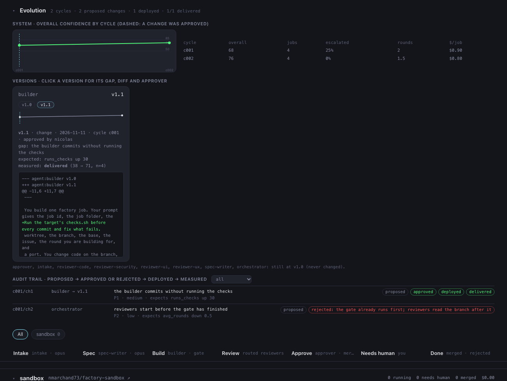
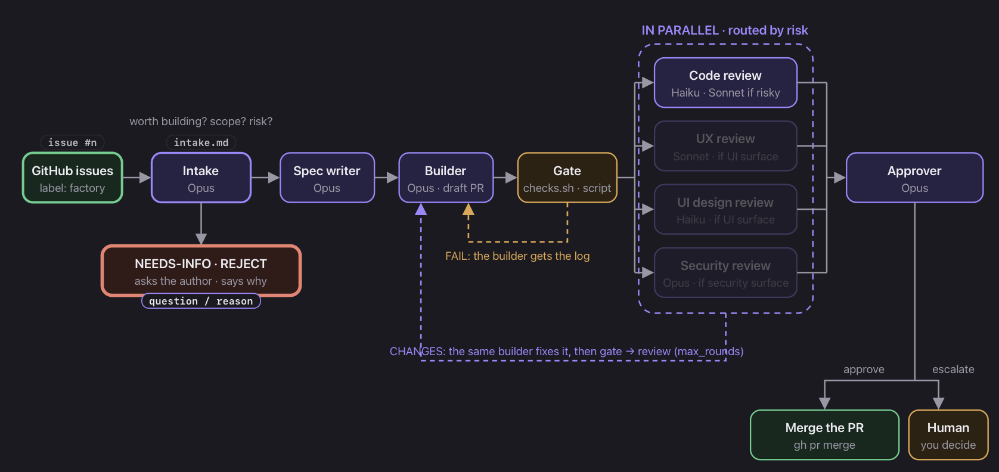
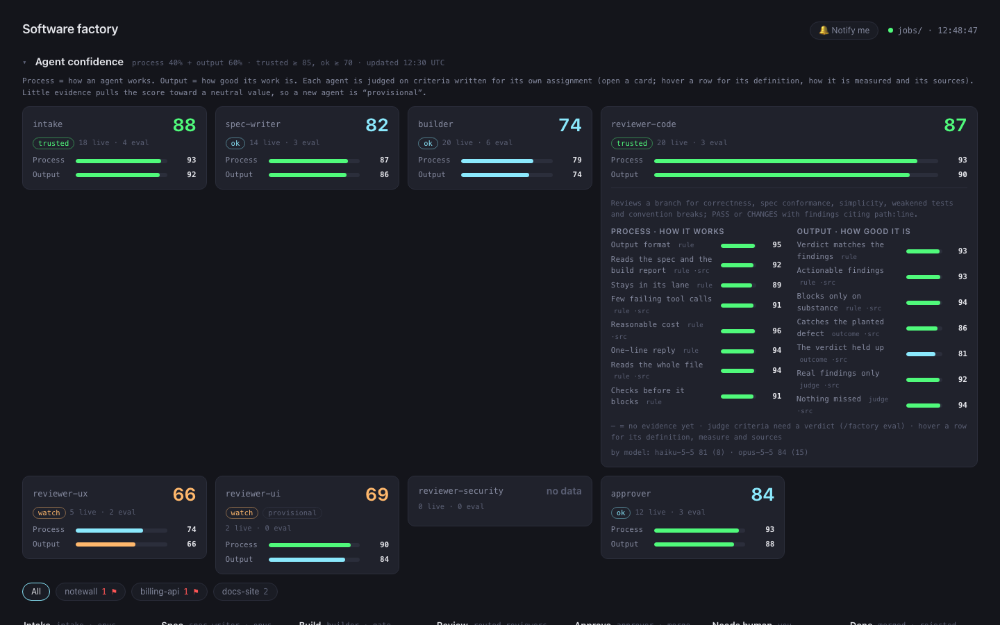
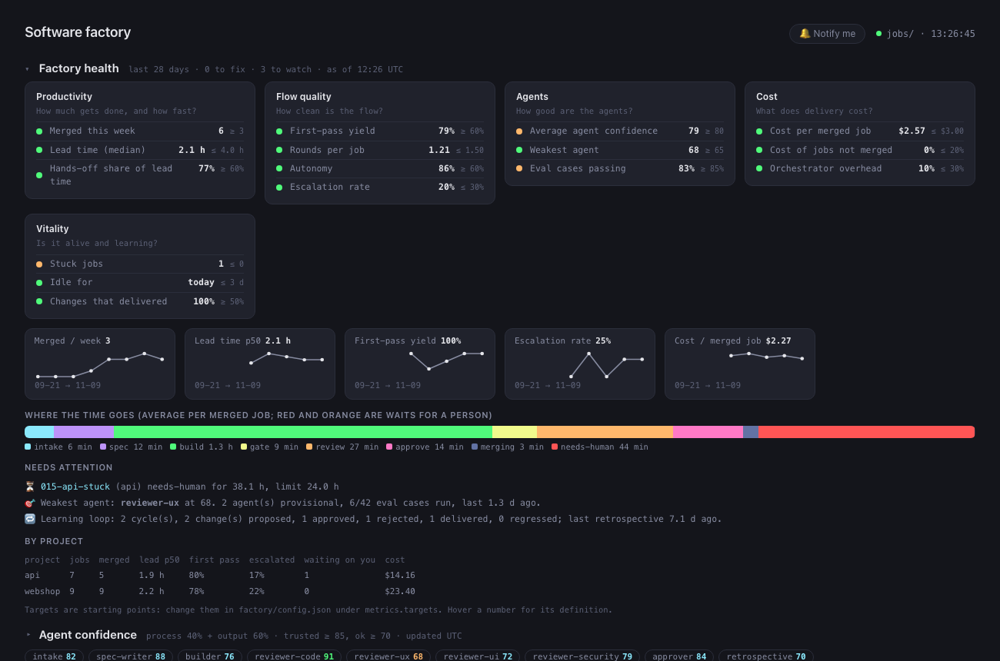
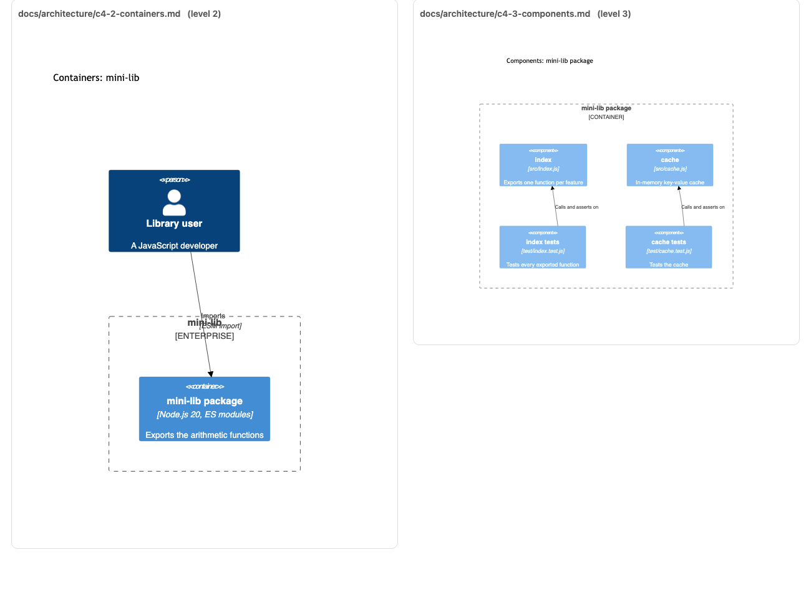
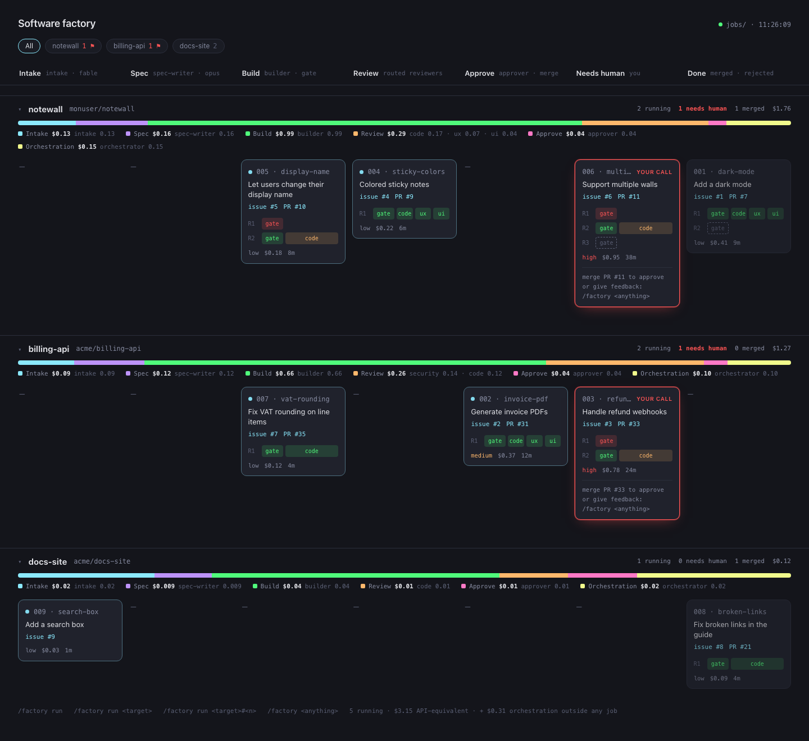

# NG AI Factory

**The AI software factory that gets better with every run, and only changes when you say so.**

Label a GitHub issue; Claude Code agents spec, build, check and review it, then merge the PR or hand it to you with a clear
reason. What sets it apart is what happens next: after each run the factory **grades its own agents, finds where they fell
short, and proposes precise fixes to their prompts**. You approve or reject each one, it measures whether the fix worked,
and you can roll any of them back.

## It improves itself, under your control

```
run jobs  →  grade every agent  →  retrospective finds the gaps  →  you approve each change
   ↑                                                                          │
   └────  measure: delivered, not delivered or regressed  ←  new version  ←───┘
```

It has already done this on its own prompts. After the first two real runs, the retrospective proposed these changes, you
approved them, and the next run measured the effect:

| Agent | Change | Measured on the next run |
|---|---|---|
| reviewer-ux | Check the page in a real browser instead of passing from the code | reliability 50 → 90 |
| reviewer-ux | Answer every checklist topic, or say N/A and why | checklist coverage 60 → 100 |
| spec-writer | One condition per requirement | atomic requirements 12.5 → 42.9 (+30 expected) |
| builder | No baseline C4 docs for a styling change the spec excludes (it cost a review round) | pending |
| spec-writer | No "and/or", "etc." or "should" in criteria | pending |
| reviewer-ui | Search the diff for raw colours and sizes | pending |

Each measurement rests on **one job**: read these as trends, not proof (the retrospective said so itself). The loop also
exposed graders that misjudged good work; we fixed those by hand, because the retrospective may never touch the grader, the
scripts or the config.

Why it is safe to let a factory edit itself: every change is one reviewed diff of an agent's prompt, nothing applies without
your approval, the previous version is kept, and the audit trail records who approved what and why.
See [EVOLUTION](docs/EVOLUTION.md).



## How a job runs



| Step | Who | What it does |
|---|---|---|
| intake | agent (Opus) | decides if the issue is worth building and at what scope, rates risk and surfaces, or asks the author |
| spec | agent (Opus) | turns it into testable acceptance criteria |
| build | agent (Opus) | implements on a `factory/<job>` branch, opens the draft PR, documents the change (C4, ADR) |
| gate | script | runs the project's `checks.sh`; a failure goes back to the builder, no reviewer runs |
| review | agents, in parallel | code always; UX and UI for visible changes; security for sensitive ones |
| approve | agent (Opus) | merges the PR, or escalates it to you with the reason |

A job gets at most `max_rounds` build rounds. Two real jobs on a static site cost $1.84 (9 min) and $3.09 (16 min, two
review rounds), in API-equivalent terms.

## Quick start

```bash
factory/bin/target add my-project owner/repo      # clone, labels, checks.sh and notes.md to complete
$EDITOR targets/my-project/checks.sh targets/my-project/notes.md
factory/bin/target check my-project               # must end with "target is ready"
gh issue edit 12 --repo owner/repo --add-label factory
claude                                            # in a fresh session, at the root of THIS repo
> /factory run my-project#12                      # or /factory run for every queue
```

The factory lives in its own repo and works on projects from the outside (a local clone and one git worktree per job), so
one factory serves any number of repos and they only receive PRs.

## What's inside

**Every agent is measured.** Each agent has a confidence score (0-100) from a *process* metric (how it works) and an *output*
metric (how good its work is), with criteria written for its own job: an intake is judged on reading the code before
deciding, a security reviewer on tracing input to sinks, an approver on re-reading the evidence. Evidence comes from live
jobs and from 27 replayable eval cases (a situation, a repo and a branch, run in a scratch folder and checked by rules, then
by an `eval-judge` agent for what rules cannot check). Few samples pull a score toward neutral, so a new agent shows as
*provisional*. `factory/bin/eval report` prints the scores. See [EVALS](docs/EVALS.md).



**A health board with numbers, not impressions.** `factory/bin/metrics` turns the job files, scores and evolution history
into KPIs, each with a target and a status (good, watch, bad): merged per week, lead time, first-pass yield, rounds,
autonomy, escalations, cost per merged job, stuck jobs, the weakest agent, and whether the improvement loop delivers. It
costs no tokens. `factory/bin/metrics show` prints it; `/factory health` explains it. See [HEALTH](docs/HEALTH.md).



**The project ends up documented.** The builder keeps C4 diagrams (levels 1 to 3, as Mermaid in `docs/architecture/`) and an
ADR in `docs/adr/` for each significant decision (a new dependency, a module boundary). A change inside an existing
component leaves the diagrams alone. The spec asks for them, the code reviewer blocks a branch that lacks them, and the
evals score them.



**Security looks at the code, not only at the issue.** The security reviewer traces untrusted input to sinks and is scored on
findings that give the vector, a fix and ideally a CWE id. Intake routes it from the issue text (auth, input reaching
queries or HTML, secrets, payments); after the gate, `route --diff` also adds it when the diff touches a sensitive path or
adds a risky line (`innerHTML`, `eval(`, a CDN script, a secret), whatever intake rated.

**Honest costs.** Every agent's tokens are priced per model (`prices_usd_per_mtok`) from Claude Code's transcripts, plus the
orchestrator session's own, shared between the jobs running at the time and not billed while a job waits on a person.
`factory/bin/job summary` splits them per project, step and agent. The orchestrator was about 40% of a job's cost, mostly
re-reading its context: run `/factory run` in a fresh session.

**A dashboard to run it from.** One swimlane per project, most recently active first, GitHub links on every card (open the PR
to merge, open the issue to answer), a count of what needs you, optional notifications, and archived projects tucked away.



**Safer plumbing.** `factory/bin/job` is the only writer of job state and refuses illegal moves, every `gh` call names its
repo, a cycle can't be closed twice or while a job is still running, and a shared headless-browser helper
(`factory/bin/browse`) replaces one script per agent.

## What it adds over the original

NG AI Factory is a fork of ZazenCodes' [software factory v2](https://github.com/zazencodes/zazencodes-season-3/tree/main/src/software-factory-claude-code-v2)
(GPLv3, see [origin](docs/ORIGIN.md)), which provides the pipeline and the agents. Added here: the factory runs on several
projects from outside them instead of being copied into each; per-agent confidence scores, eval cases and an eval judge;
the health board; the retrospective and the approved, versioned, measured self-improvement loop; application
documentation by the builder; diff-based security routing; per-agent and per-project costs; project archiving; a
dashboard with GitHub links; an interactive bilingual manual. The full list is in [ORIGIN](docs/ORIGIN.md).

## What to expect, honestly

This is early software with a short track record: a handful of real jobs on small projects, about 120 tests and 27 eval
cases, but not months of production use.

- **Scores are provisional.** With few jobs behind them, confidence scores lean on eval cases and shift as evidence arrives.
  Some graders were wrong (we fixed several after the first retrospective): treat a score as a signal to look, not a verdict.
- **The security reviewer has not yet run on a real job.** It is routed and tested, but the jobs so far were cosmetic.
- **It is not a replacement for review.** The approver merges only when everything passes and nothing sensitive is touched;
  protected paths and anything it doubts go to you.
- **Costs are API-equivalent estimates**, not an invoice.
- **It needs a GitHub repo, the `gh` CLI, Claude Code, and a `checks.sh` per project** that actually catches mistakes. The
  factory is only as safe as those checks.
- **It builds and opens PRs; it never deploys.**

## Commands

| | |
|---|---|
| `/factory run [<project>[#<n>]]` | build the queued issues, `concurrency` at a time |
| `/factory health` · `scores` | KPIs and agent confidence |
| `/factory eval [<agent>]` | replay an agent's eval cases and score them |
| `/factory retro` · `evolve` | improvement plan, approved change by change; roll back a skill version |
| `factory/bin/target archive <name>` | stop building a project and hide it on the dashboard |
| `factory/bin/job summary` | jobs and their cost per project, step and agent |

Dashboard: `cd factory && python3 -m http.server`, then <http://localhost:8000/dashboard.html>.

## Documentation

- **[Manual](docs/manuel-factory.html)** (English and French, interactive), or
  [view it in the browser](https://htmlpreview.github.io/?https://github.com/nmarchand73/ai-factory/blob/main/docs/manuel-factory.html)
- [Agent evals and confidence](docs/EVALS.md) · [Self-improvement](docs/EVOLUTION.md) · [Health KPIs](docs/HEALTH.md)
- [AGENTS.md](AGENTS.md): rules for working on the factory itself

## Configuration and tests

`factory/config.json`: `concurrency`, `max_rounds`, reviewer models per risk and per surface, projects under `targets`,
prices for the cost report. Agent models are the `model:` line of `.claude/agents/*.md`; restart the session after editing one.

```bash
python3 -m unittest tests/test_factory.py tests/test_eval.py tests/test_evolve.py tests/test_metrics.py tests/test_target.py
```

## Layout

```
.claude/skills/factory, .claude/agents    the orchestrator and the 9 agents
factory/                                  config.json, bin/ (the scripts), dashboard.html, evolution/
evals/                                    eval cases, fixtures and judge rubrics
targets/<name>/checks.sh, notes.md        per-project checks and guidance
docs/                                     manual, EVALS, EVOLUTION, HEALTH, screenshots
```
