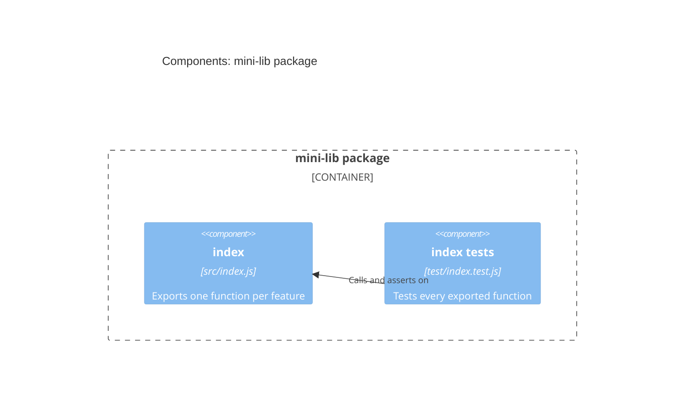

# C4 level 3: components of the mini-lib package

| Component | Path | Responsibility |
|---|---|---|
| index | `src/index.js` | One exported function per feature |
| index tests | `test/index.test.js` | Tests for every exported function (`node --test`) |
