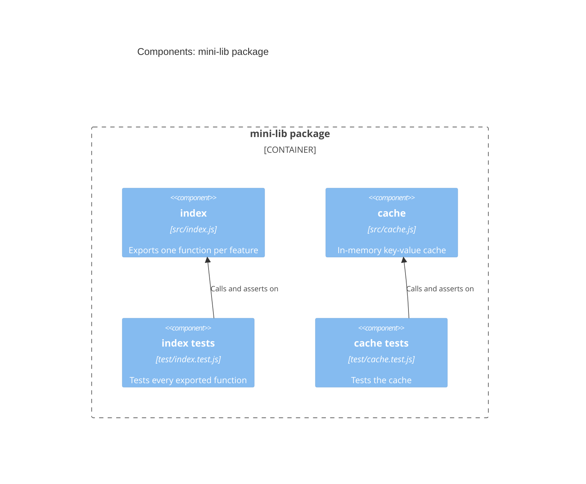

# C4 level 3: components of the mini-lib package

| Component | Path | Responsibility |
|---|---|---|
| index | `src/index.js` | One exported function per feature |
| cache | `src/cache.js` | In-memory key-value cache |
| cache tests | `test/cache.test.js` | Tests for the cache (`node --test`) |
| index tests | `test/index.test.js` | Tests for every exported function (`node --test`) |
